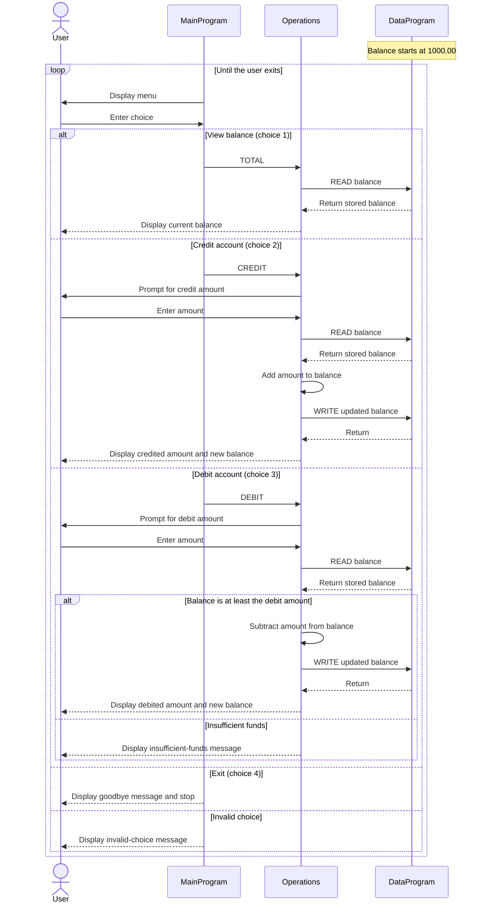

# COBOL Account Management

This directory documents the COBOL account-management example in `src/cobol`.
The program provides a menu to view a balance, credit an account, or debit an
account. Although this repository is about student accounts, the COBOL code
does not identify students or implement student-specific account rules.

## COBOL programs

| File | Purpose and key behavior |
| --- | --- |
| `main.cob` | Defines `MainProgram`, the interactive entry point. Its `MAIN-LOGIC` paragraph displays the menu, accepts a choice, and calls `Operations` with `TOTAL`, `CREDIT`, or `DEBIT`. Choice 4 exits; other choices display an invalid-choice message. |
| `operations.cob` | Defines `Operations`, which handles the requested account action. For `TOTAL`, it reads and displays the balance. For `CREDIT`, it accepts an amount, reads the balance, adds the amount, writes the result, and displays it. For `DEBIT`, it accepts an amount and subtracts it only when the balance is at least that amount; otherwise, it displays an insufficient-funds message. |
| `data.cob` | Defines `DataProgram`, the balance store. Its procedure accepts an operation and balance through the linkage section: `READ` copies the stored balance to the caller, and `WRITE` replaces the stored balance. The stored balance starts at `1000.00`. |

## Account rules represented in the code

- The account balance is initialized to `1000.00`.
- A credit adds the entered amount to the balance.
- A debit is applied only when the current balance is greater than or equal to
  the entered amount. A debit larger than the balance is rejected with an
  insufficient-funds message and does not write a new balance.
- The balance and transaction amount use `PIC 9(6)V99` fields, providing six
  integer digits and two decimal digits.

## Student-account scope

The programs manage one shared balance. They contain no student ID or profile
data, account selection, per-student balance storage, or student-specific
eligibility, fee, or transaction rules. They also do not explicitly validate
entered amounts or handle balance overflow.

## Application data flow

